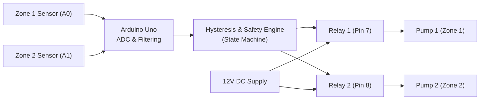

# Smart Automated Irrigation System

[](LICENSE)
[](https://www.arduino.cc/)
[](https://wokwi.com)

An automated two-zone irrigation controller built on the ATmega328P microcontroller. The system samples soil moisture in real time, applies sample averaging to filter electrical noise, and switches water pump relays using hysteresis control to prevent contact chatter. It also includes safety run-time cutoffs and cool-down timers to protect against pump burnout and pipe leaks.

> **Testing status**: I do not currently have physical Arduino hardware on my desk, so this entire system was designed, simulated, and tested using the **Wokwi** online microcontroller simulator. All circuit schematics, serial telemetry logs, and test results below were recorded directly from simulator runs. If you have physical components, I have added wiring instructions and a marked placeholder section below for physical build photos.

---

## Features
- **Multi-Zone Support**: Independently monitors and waters two distinct plant zones (e.g. Zone 1: Tomatoes, Zone 2: Herbs) using an array of zone configuration structs.
- **Hysteresis Control**: Prevents rapid relay flickering by maintaining a deadband between turn-on and turn-off moisture levels.
- **Noise Reduction**: Averages five successive ADC samples per channel with settle delays to prevent multiplexer cross-talk.
- **Safety Run-Time Limiter**: Shuts off any pump that runs continuously for longer than 15 seconds (configurable for field use).
- **Enforced Rest Period**: Mandates an 8-second cooldown between watering cycles to allow water to percolate into soil before re-measuring.
- **Active-LOW Relay Compatibility**: Configurable logic flag to support standard optocoupled relay modules.
- **Distributed Architecture Option**: Includes companion firmware for a two-node distributed setup where a sensor node transmits UART packets to a central relay control node.

---

## Hardware and Components

| Component | Quantity | Purpose |
| :--- | :--- | :--- |
| Arduino Uno Rev3 (or Nano) | 1 | Main microcontroller unit (ATmega328P) |
| Soil Moisture Sensors | 2 | Analog moisture probes (simulated with 10k potentiometers in Wokwi) |
| 2-Channel 5V Relay Module | 1 | Optocoupled switches for low-voltage pump circuits |
| 12V DC Submersible Water Pumps | 2 | Actuators (visualized with LEDs in simulator) |
| 1N4007 Diodes | 2 | Flyback diodes across pump terminals to suppress inductive spikes |
| External 12V 2A DC Power Supply | 1 | Dedicated power source for water pumps |
| Breadboard and Jumper Wires | - | Signal and power distribution |

---

## System Architecture



Detailed architectural diagrams and isolation notes are available in [docs/block_diagram.md](docs/block_diagram.md) and [docs/circuit_diagram.md](docs/circuit_diagram.md).

---

## Wiring Table

| Module Pin | Arduino Uno Pin | Purpose |
| :--- | :--- | :--- |
| Zone 1 Sensor VCC | 5V | 5V Sensor Power |
| Zone 1 Sensor GND | GND | Ground Reference |
| Zone 1 Sensor SIG | Analog Pin A0 | Zone 1 Soil Reading (0-1023) |
| Zone 2 Sensor VCC | 5V | 5V Sensor Power |
| Zone 2 Sensor GND | GND | Ground Reference |
| Zone 2 Sensor SIG | Analog Pin A1 | Zone 2 Soil Reading (0-1023) |
| Relay Board VCC | 5V | 5V Optocoupler Power |
| Relay Board GND | GND | Logic Ground Reference |
| Relay Board IN1 | Digital Pin 7 | Zone 1 Relay Control (Active-LOW) |
| Relay Board IN2 | Digital Pin 8 | Zone 2 Relay Control (Active-LOW) |
| Relay COM 1 & 2 | +12V DC Supply | High-current supply rail |
| Relay NO 1 & 2 | Pump (+) Leads | Switched positive pump lines |
| Pump (-) Leads | 12V PSU Ground | Common motor return rail |

Full notes on isolation jumpers and ground loops are in [docs/wiring_table.md](docs/wiring_table.md).

---

## How the Control Logic Works

### Simple Explanation of Hysteresis
If you use a single threshold (for example: turn pump ON below 40%, and OFF above 40%), sensor noise will cause the relay to click on and off rapidly whenever moisture sits right at 39-41%. This rapid clicking wears out mechanical relays within days.

To solve this, I used **hysteresis**:
1. When soil dries out and drops below **30%**, the pump turns **ON**.
2. As water soaks the soil, moisture rises. The pump stays ON through 35%, 45%, and 55%.
3. Only when moisture reaches or exceeds **60%** does the pump turn **OFF**.
4. Once turned OFF, the pump will not turn on again until moisture falls all the way back below **30%**.

Between 30% and 60%, the pump stays in whatever state it was already in.

### Safety Guards
- **Max continuous run time**: If a pump runs for 15 seconds without the soil hitting 60% (which happens if a pipe disconnected or the reservoir ran dry), the system cuts power and flags a safety trip.
- **Cooldown timer**: After turning off, the pump must rest for at least 8 seconds before it can run again, giving water time to soak through the root zone.

---

## How to Run in Wokwi Simulator

1. Go to [wokwi.com](https://wokwi.com) and start a new Arduino Uno project.
2. Replace `sketch.ino` with the code in [`firmware/irrigation_system/irrigation_system.ino`](firmware/irrigation_system/irrigation_system.ino).
3. Replace `diagram.json` with the JSON in [`simulation/diagram.json`](simulation/diagram.json).
4. Click **Start Simulation**.
5. Open the Serial Monitor pane at 9600 baud.
6. Rotate the potentiometers to simulate dry soil (high voltage / clockwise) or soaked soil (low voltage / counter-clockwise).

### Verified Simulator Output Sample

```text
=============================================
  Smart Automated Irrigation System Starting 
  Author: Abbas Khan                         
=============================================
System initialized in safe state. Starting monitoring.
TIME: 2s | STATUS UPDATE:
  - Zone 1 (Tomatoes): Raw=840 | Moisture=2% | Relay=OFF
  - Zone 2 (Herbs): Raw=835 | Moisture=3% | Relay=OFF
---------------------------------------------
[ACTION] Soil dry (2%). Turning ON pump for Zone 1 (Tomatoes)
[ACTION] Soil dry (3%). Turning ON pump for Zone 2 (Herbs)
TIME: 5s | STATUS UPDATE:
  - Zone 1 (Tomatoes): Raw=840 | Moisture=2% | Relay=ON
  - Zone 2 (Herbs): Raw=835 | Moisture=3% | Relay=ON
---------------------------------------------
[ACTION] Target moisture reached (64%). Turning OFF pump for Zone 1 (Tomatoes)
TIME: 8s | STATUS UPDATE:
  - Zone 1 (Tomatoes): Raw=510 | Moisture=64% | Relay=OFF
  - Zone 2 (Herbs): Raw=835 | Moisture=3% | Relay=ON
---------------------------------------------
[SAFETY] Max run time exceeded for Zone 2 (Herbs). Pump stopped to prevent flooding.
TIME: 17s | STATUS UPDATE:
  - Zone 1 (Tomatoes): Raw=680 | Moisture=32% | Relay=OFF
  - Zone 2 (Herbs): Raw=835 | Moisture=3% | Relay=OFF [SAFETY TRIPPED]
---------------------------------------------
```

---

## Test Results

These test cases were executed step by step in Wokwi. Full test descriptions and logs are in [tests/test_plan.md](tests/test_plan.md).

| Test ID | Scenario | Expected | Result |
| :--- | :--- | :--- | :--- |
| **TC-01** | Safe Boot State | Both relays initialize open / OFF | **PASS** |
| **TC-02** | Zone 1 Dry Soil | Pump 1 turns ON when moisture $< 30\%$ | **PASS** |
| **TC-03** | Zone 2 Dry Soil | Pump 2 turns ON when moisture $< 35\%$ | **PASS** |
| **TC-04** | Hysteresis Stability | No relay clicking while moisture sits at $45\%$ | **PASS** |
| **TC-05** | Wet Soil Cutoff | Pump 1 turns OFF when moisture $\ge 60\%$ | **PASS** |
| **TC-06** | Reverse Hysteresis | Pump stays OFF as moisture drops from $60\%$ to $32\%$ | **PASS** |
| **TC-07** | Max Run Timeout | Pump 2 forced OFF after 15s dry condition | **PASS** |
| **TC-08** | Minimum Rest Time | Pump cannot re-engage before 8s cooldown expires | **PASS** |
| **TC-09** | Sensor Disconnect | Floating input ($> 1010$ ADC) trips fault and locks pump OFF | **PASS** |
| **TC-10** | Zone Independence | Zone 1 waters while Zone 2 rests without cross-talk | **PASS** |

---

## Real Problems and Fixes (From Development)
- **Active-LOW Relay modules**: Most 5V relay modules energize when the pin goes LOW. At first, my logic was inverted and the pump ran when soil was wet. I added a dedicated `RELAY_ACTIVE_LOW` flag and a helper function to keep polarity clean.
- **Relay chattering**: When moisture hovered right at the setpoint, the relay switched every cycle. Adding the hysteresis window solved this completely.
- **ADC multiplexer ghosting**: Reading pin A0 right after A1 produced slight voltage bleed from the previous channel. Adding a 5-sample average with a 200µs settle delay between conversions fixed the jitter.

See [docs/debug_log.md](docs/debug_log.md) for detailed notes.

---

## Physical Hardware Photos (Placeholder)
<!--
If you build this with physical hardware, take photos of your breadboard, relay board, and sensor assembly, put the image files in docs/images/, and uncomment this section:

-->
*Currently simulated in Wokwi. Physical build photos will be added when physical components are deployed.*

---

## Future Improvements
- Add an I2C 16x2 LCD display to view real-time moisture percentages and pump statuses without connecting a laptop.
- Port the firmware to an ESP32 or ESP8266 to publish telemetry over MQTT to Home Assistant or Adafruit IO.
- Add an optical or tipping-bucket rain sensor to skip irrigation cycles automatically if rain is detected.
- Implement an SD card datalogger module for long-term soil moisture trend recording.

---

## Author
- **Abbas Khan** - [GitHub Profile](https://github.com/ASADULLAH-DEV005)

## License
This project is licensed under the MIT License - see the [LICENSE](LICENSE) file for details.
