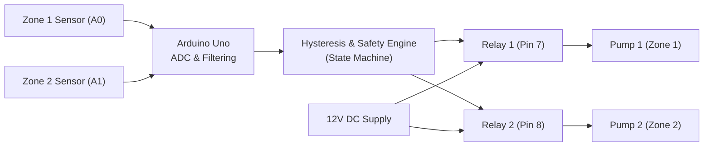

# Smart Automated Irrigation System

An automated two-zone irrigation controller designed for the ATmega328P microcontroller (Arduino Uno / Nano). The firmware samples soil moisture across two separate zones, averages successive ADC readings to filter electrical noise, and switches water pump relays using hysteresis control to prevent rapid contact cycling. It also includes safety cutoffs for continuous pump runtime and enforced cooldown intervals.

> **Hardware & Testing Status**: I do not have physical Arduino hardware on my desk, and `arduino-cli` is not installed in this environment. The circuit schematic and firmware are prepared and structured for the **Wokwi** online microcontroller simulator. The test cases in `tests/test_plan.md` define the full verification procedure and are currently marked as **NOT RUN** until executed in an interactive simulator session or on hardware.

---

## Features
- **Multi-Zone Architecture**: Manages two independent plant zones (e.g. Zone 1: Tomatoes, Zone 2: Herbs) with separate pin assignments, calibration thresholds, and timers.
- **Hysteresis Control**: Prevents rapid relay flickering by maintaining a deadband between turn-on and turn-off moisture levels.
- **Noise Filtering**: Averages five successive ADC samples per channel with settle delays to reduce analog multiplexer noise.
- **Safety Run-Time Limiter**: Shuts off any pump that runs continuously for longer than 15 seconds (protects against pipe leaks and dry reservoirs).
- **Enforced Rest Period**: Mandates an 8-second cooldown between watering cycles so water can percolate into soil before re-measuring.
- **Active-LOW Relay Flag**: Configurable logic flag to support standard optocoupled relay modules.
- **Distributed Architecture Option**: Includes companion firmware for a two-node distributed setup where a sensor node sends UART packets to a central relay control node.

---

## Hardware and Components

| Component | Quantity | Purpose |
| :--- | :--- | :--- |
| Arduino Uno Rev3 (or Nano) | 1 | Microcontroller unit (ATmega328P) |
| Soil Moisture Sensors | 2 | Analog moisture probes (modeled with 10k potentiometers in Wokwi) |
| 2-Channel 5V Relay Module | 1 | Optocoupled switches for low-voltage pump circuits |
| 12V DC Submersible Water Pumps | 2 | Actuators (visualized with LEDs in simulator) |
| 1N4007 Diodes | 2 | Flyback diodes across pump terminals to suppress inductive spikes |
| External 12V 2A DC Power Supply | 1 | Dedicated power source for water pumps |
| Breadboard and Jumper Wires | - | Signal and power distribution |

---

## System Architecture

Detailed architectural diagrams and isolation notes are available in [docs/block_diagram.md](docs/block_diagram.md) and [docs/circuit_diagram.md](docs/circuit_diagram.md).

---

## Wiring Table

| Module Pin | Arduino Uno Pin | Purpose |
| :--- | :--- | :--- |
| Zone 1 Sensor VCC | 5V | 5V Sensor Power |
| Zone 1 Sensor GND | GND | Ground Reference |
| Zone 1 Sensor SIG | Analog Pin A0 | Zone 1 Soil Reading (0-1023) |
| Zone 2 Sensor VCC | 5V | 5V Sensor Power |
| Zone 2 Sensor GND | GND | Ground Reference |
| Zone 2 Sensor SIG | Analog Pin A1 | Zone 2 Soil Reading (0-1023) |
| Relay Board VCC | 5V | 5V Optocoupler Power |
| Relay Board GND | GND | Logic Ground Reference |
| Relay Board IN1 | Digital Pin 7 | Zone 1 Relay Control (Active-LOW) |
| Relay Board IN2 | Digital Pin 8 | Zone 2 Relay Control (Active-LOW) |
| Relay COM 1 & 2 | +12V DC Supply | High-current supply rail |
| Relay NO 1 & 2 | Pump (+) Leads | Switched positive pump lines |
| Pump (-) Leads | 12V PSU Ground | Common motor return rail |

Full notes on isolation jumpers and ground loops are in [docs/wiring_table.md](docs/wiring_table.md).

---

## Control Logic & Hysteresis

### How Hysteresis Prevents Relay Chatter
If a system uses a single threshold (such as: pump ON below 40%, pump OFF above 40%), sensor noise will cause the relay to click on and off rapidly whenever moisture hovers right around 39% - 41%.

To prevent this:
1. When soil dries out and drops below **30%**, the pump turns **ON**.
2. As water soaks the soil, moisture rises. The pump stays ON through 35%, 45%, and 55%.
3. Only when moisture reaches or exceeds **60%** does the pump turn **OFF**.
4. Once turned OFF, the pump will not turn on again until moisture falls all the way back below **30%**.

Between 30% and 60%, the pump stays in its previous state.

### Safety Guards
- **Max continuous run time**: If a pump runs for 15 seconds without reaching cutoff moisture, the controller turns the relay OFF and enters a safety lockout.
- **Cooldown timer**: After turning off, the pump must rest for at least 8 seconds before it can run again, allowing water to percolate into the root zone.

---

## How to Simulate in Wokwi

1. Open [wokwi.com](https://wokwi.com) in your browser.
2. Choose **Arduino Uno**.
3. Replace the code in `sketch.ino` with [`firmware/irrigation_system/irrigation_system.ino`](firmware/irrigation_system/irrigation_system.ino).
4. Switch to the `diagram.json` tab and paste the contents of [`simulation/diagram.json`](simulation/diagram.json).
5. Click **Start Simulation**.
6. Open the Serial Monitor pane at 9600 baud.
7. Rotate the potentiometers to simulate dry soil (clockwise / higher voltage) and wet soil (counter-clockwise / lower voltage).

---

## Test Specification

The test plan in [tests/test_plan.md](tests/test_plan.md) outlines 10 verification test cases:

| Test ID | Scenario | Expected Behavior | Status |
| :--- | :--- | :--- | :--- |
| **TC-01** | Safe Boot State | Both relays initialize open / OFF | NOT RUN |
| **TC-02** | Zone 1 Dry Soil | Pump 1 turns ON when moisture $< 30\%$ | NOT RUN |
| **TC-03** | Zone 2 Dry Soil | Pump 2 turns ON when moisture $< 35\%$ | NOT RUN |
| **TC-04** | Hysteresis Stability | No relay clicking while moisture sits at $45\%$ | NOT RUN |
| **TC-05** | Wet Soil Cutoff | Pump 1 turns OFF when moisture $\ge 60\%$ | NOT RUN |
| **TC-06** | Reverse Hysteresis | Pump stays OFF as moisture drops from $60\%$ to $32\%$ | NOT RUN |
| **TC-07** | Max Run Timeout | Pump 2 forced OFF after 15s continuous run | NOT RUN |
| **TC-08** | Minimum Rest Time | Pump cannot re-engage before 8s cooldown expires | NOT RUN |
| **TC-09** | Sensor Disconnect | Floating input ($> 1010$ ADC) trips fault and locks pump OFF | NOT RUN |
| **TC-10** | Zone Independence | Zone 1 waters while Zone 2 rests without cross-talk | NOT RUN |

---

## Design Considerations & Common Issues to Watch For

1. **Active-LOW Relay polarity**: Most commercial 5V relay modules trigger on LOW. Ensure `RELAY_ACTIVE_LOW` is set to `true` so the relay is not energizing on startup.
2. **Sensor electrolysis**: Continuous DC current across resistive soil probes corrodes copper traces within weeks. For physical deployments, use capacitive probes (Capacitive v1.2) or power sensor VCC from an Arduino digital pin only during measurements.
3. **Power supply brownouts**: DC pumps draw high stall currents on startup. Always power pumps from an external 12V 2A DC adapter rather than the Arduino 5V regulator.
4. **Flyback voltage spikes**: Always put a 1N4007 diode across pump motor terminals in reverse bias to absorb inductive spikes when the relay disconnects.

See [docs/debug_log.md](docs/debug_log.md) for full engineering notes.

---

## Physical Hardware Photos (Placeholder)
<!--
When building this on a physical bench:
1. Photograph your breadboard, Arduino, relay module, and sensors.
2. Place photos in docs/images/.
3. Uncomment the line below:

-->
*Currently prepared for simulation. Physical build photos will be added when hardware is deployed.*

---

## Future Improvements
- Add an I2C 16x2 LCD display to view real-time moisture percentages and relay status without a PC.
- Port firmware to an ESP32 or ESP8266 to transmit MQTT telemetry to Home Assistant or Adafruit IO.
- Add an optical or tipping-bucket rain sensor to skip irrigation cycles automatically when rain is detected.
- Implement an SD card datalogger module for long-term soil moisture trend recording.

---

## Author
- **Asad** - [GitHub Profile](https://github.com/ASADULLAH-DEV005)

## License
This project is licensed under the MIT License - see the [LICENSE](LICENSE) file for details.
